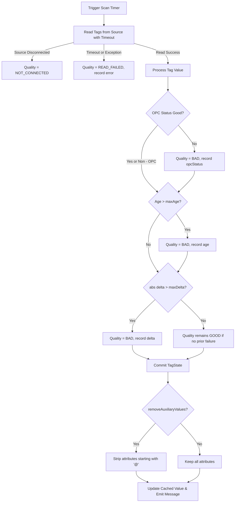

# Tag State and Quality in TagTable

The tag state and quality subsystem in `controls-table` provides automated health monitoring, data validity assessment,
and provenance tracking for real-time and historical time-series data.

By associating validity indicators and diagnostic metadata with raw device readings, downstream consumers (such as
control loops, analytics engines, visualization dashboards, and long-term storage) can reliably distinguish trustworthy
measurements from stale, disconnected, or out-of-bounds data.

---

## 1. Core Model (`TagState`)

A `TagState` encapsulates the operational health and diagnostic metadata of a tag measurement:

```kotlin
@JvmInline
public value class TagState(public val value: Meta) {
    public val quality: String? get() = value[TagState.quality]
}
```

### Predefined Quality States

| Quality State   | Constant                         | Description                                                                                                             |
|-----------------|----------------------------------|-------------------------------------------------------------------------------------------------------------------------|
| `GOOD`          | `TagState.GOOD_QUALITY`          | The tag value is valid, timely, and satisfies all configured verification criteria.                                     |
| `BAD`           | `TagState.BAD_QUALITY`           | The tag value failed one or more validation checks (e.g., bad source status, stale timestamp, or delta limit exceeded). |
| `READ_FAILED`   | `TagState.READ_FAILED_QUALITY`   | An error occurred during tag reading (e.g., communication timeout, parser error, or unhandled exception).               |
| `NOT_CONNECTED` | `TagState.NOT_CONNECTED_QUALITY` | The data source client is unreachable or not connected.                                                                 |

### Diagnostic Metadata

When a tag's quality is degraded, `TagState.value` contains diagnostic attributes describing the underlying cause:

* **`opcStatus`**: The raw status code / identifier returned by the OPC UA server when `isGood == false`.
* **`age`**: The computed age duration string (`clock.now() - rawValue.time`) when the sample exceeds `maxAge`.
* **`delta`**: The computed numerical difference (`newValue - oldValue`) when the change between successive samples
  exceeds `maxDelta`.
* **`error`**: The exception message or error description when a read operation fails.

---

## 2. Quality Configuration (`TagTableColumn`)

Quality evaluation rules are configured per tag column via `TagTableColumn`:

```kotlin
data class TagTableColumn(
    val source: String,
    val timer: String,
    val config: Meta,
    val timeout: Duration = 1.seconds,
    val compression: ColumnCompression? = null,
    val removeAuxiliaryValues: Boolean = true,
    val maxAge: Duration? = null,
    val maxDelta: Double? = null,
    val meta: Meta = Meta.EMPTY,
)
```

### Configuration Parameters

| Parameter               | Type        | Default    | Description                                                                                                                                    |
|-------------------------|-------------|------------|------------------------------------------------------------------------------------------------------------------------------------------------|
| `maxAge`                | `Duration?` | `null`     | Maximum permissible age of the raw sample relative to the table clock. If `(clock.now() - sampleTime) > maxAge`, quality is marked `BAD`.      |
| `maxDelta`              | `Double?`   | `null`     | Maximum permissible absolute difference between consecutive numeric samples (`\|newValue - oldValue\|`). If exceeded, quality is marked `BAD`. |
| `timeout`               | `Duration`  | `1.second` | Maximum duration allowed for the source read operation. Exceeding timeout marks quality as `READ_FAILED`.                                      |
| `removeAuxiliaryValues` | `Boolean`   | `true`     | When `true`, auxiliary metadata attributes (keys starting with `@`, such as `@opc.*`) are stripped from the tag's stored value `Meta`.         |

### Column Factory DSL

Factory functions on `TagTableColumn.Companion` simplify configuring quality rules across different source types:

```kotlin
// OPC UA Column with max age and max delta checks
val temperatureColumn = TagTableColumn.opc(
    source = "opcServer",
    timer = "fastScan",
    nodeId = "ns=2;s=Sensors/Temperature",
    maxAge = 2.seconds,
    maxDelta = 5.0,
    removeAuxiliaryValues = true
)

// Modbus Column with delta validation
val pressureColumn = TagTableColumn.modbus(
    source = "modbusDevice",
    timer = "fastScan",
    reader = ModbusTagReader.HOLDING_REGISTERS,
    address = 100,
    maxDelta = 10.0
)

// PLC4X Column with staleness limit
val flowColumn = TagTableColumn.plc4x(
    source = "plc",
    timer = "fastScan",
    address = "%DB1:DBD0:REAL",
    plcValueType = PlcValueType.FLOAT,
    maxAge = 500.milliseconds
)
```

---

## 3. Quality Evaluation Algorithm

`PlcTagTable` evaluates quality on every scan cycle during tag ingestion:



### Step-by-Step Processing

1. **Connection & Source Read**:
    - The table executes `source.readMultipleTags(...)` with the highest configured timeout among entries.
    - If the source is disconnected or returns `null`, the tag state is assigned `NOT_CONNECTED`.
    - If an exception occurs, the tag state is assigned `READ_FAILED` with the exception message stored under `error`.

2. **OPC Status Verification**:
    - For OPC UA values, the OPC status is extracted via `Opc.getOpcStatus(rawValue.value)`.
    - If present and `opcStatus.isGood == false`, quality is set to `BAD` and `opcStatus` is recorded.

3. **Staleness Check (`maxAge`)**:
    - If `column.maxAge` is set, the age is computed as `age = clock.now() - rawValue.time`.
    - If `age > column.maxAge`, quality is set to `BAD` and `age` is recorded.

4. **Rate-of-Change / Outlier Check (`maxDelta`)**:
    - If `column.maxDelta` is configured and both previous and current values are parseable as `Double`, the absolute
      difference `abs(newValue - oldValue)` is evaluated.
    - If `abs(newValue - oldValue) > column.maxDelta`, quality is set to `BAD` and `delta` is recorded.

5. **State Commitment and Sanitization**:
    - The computed `TagState` is stored in the table's state cache and accessible via `readTagQuality(tag)`.
    - If `column.removeAuxiliaryValues == true`, auxiliary fields (starting with `@`) are stripped from the value
      payload.
    - The sanitized `ValueWithTime` is cached and published to `messageFlow`.

---

## 4. Consuming Tag Quality

### Programmatic Access

```kotlin
// Read current tag value
val value: Meta = tagTable.readTag("temperature")

// Read latest quality state and diagnostics
val state: TagState = tagTable.readTagQuality("temperature")
println("Quality: ${state.quality}") // "GOOD", "BAD", "READ_FAILED", etc.
println("Diagnostics: ${state.value}")
```

### Time-Series Streaming with Quality Columns

When generating time-series flows with `withTagQuality = true`, `TagTable` appends a companion quality column for every
tag named `<tag>.@quality` (`TagState.TAG_QUALITY_SUFFIX`). The `includeOldValues` flag (default: `true`) controls whether
stale values older than `interval` are retained or omitted from the time-series rows:

```kotlin
val timeSeries = tagTable.readTimeSeries(
    interval = 100.milliseconds,
    withTagQuality = true,
    includeOldValues = true
)
```

#### Row Structure Example (JSON representation)

```json
{
  "@time": "2026-10-19T12:00:00Z",
  "temperature": 25.4,
  "temperature.@quality": {
    "quality": "GOOD"
  },
  "pressure": 150.0,
  "pressure.@quality": {
    "quality": "BAD",
    "delta": 45.2
  }
}
```

### Persistence and Storage (`storeData` / `flowBinaryData`)

To persist tag quality metadata in historical envelope files, enable `withTagState = true`:

```kotlin
// In configuration
val storageConfig = TagTableStorageConfiguration(
    path = "data/storage",
    readInterval = 1.seconds,
    withTagState = true
)

// Or via streaming extensions
tagTable.flowBinaryData(
    readInterval = 1.seconds,
    converter = ZipRowsEnvelopeConverter.meta,
    withTagState = true
)
```

When compression is active, `flowBinaryData` automatically outputs full baseline rows with `readAllValuesWithTagState()`
at the beginning of each envelope block, preserving initial quality indicators across compressed data boundaries.

### Replay Support (`ReplayTagTable`)

`ReplayTagTable` reconstructs companion `*.@quality` columns from stored envelopes during playback. Calling
`readTagQuality(tag)` on a replay table returns the recorded `TagState` corresponding to the current playback position.
