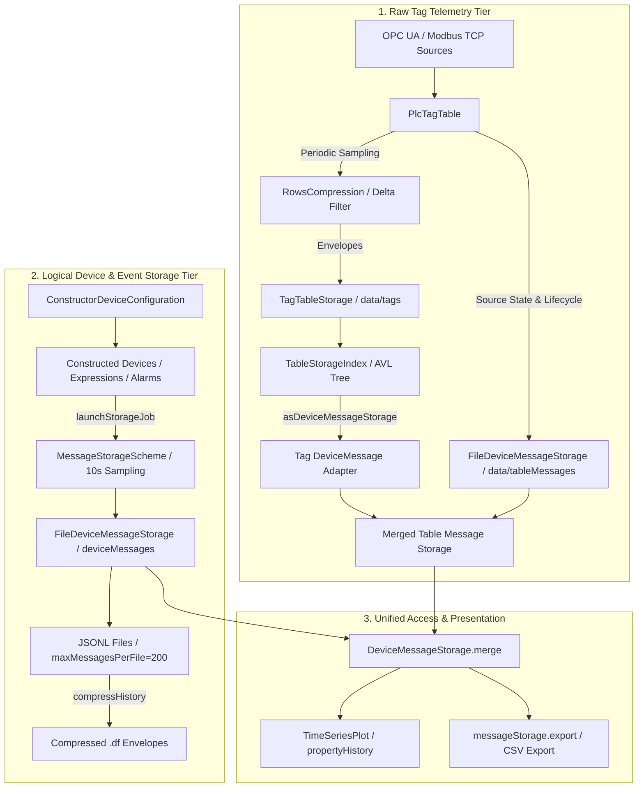

# Storage Organization in Data Platform Demo

The `data-platform-demo` module showcases a two-tier storage architecture designed to balance the demands of high-frequency raw industrial telemetry with structured, event-driven device lifecycle tracking and analytics.

---

## Architecture Overview



---

## 1. Raw Tag Time-Series Storage (`controls-table`)

When capturing dense, periodic measurements from hundreds of field tags across OPC UA and Modbus devices, logging individual message objects introduces significant storage and serialization overhead. The demo utilizes `controls-table` to store tag snapshots as compressed tabular chunks.

### Configuration (`TagTableStorageConfiguration`)

The tag storage parameters are defined in `platform-config.json` (generated during test stand setup):

```kotlin
TagTableStorageConfiguration(
    path = dataDirectory.resolve("tags").toString(),
    readInterval = 1.seconds,
    maxDuration = 30.seconds,
    compression = RowsCompression(
        skipUnchangedRows = true,
        skipUnchangedValues = true,
        numericDelta = 0.05
    ),
    separateMeta = false,
    withTagState = true
)
```

- **Sampling Cadence (`readInterval`)**: Captures complete table rows once per second.
- **Envelope Rollover (`maxDuration`)**: Flushes buffered rows into a new self-contained binary envelope every 30 seconds (or when row limits are reached).
- **Delta Compression (`RowsCompression`)**:
  - `skipUnchangedRows`: Omits an entire row if no tag values changed during the interval.
  - `skipUnchangedValues`: Excludes static column values within a row.
  - `numericDelta`: Filters out analog noise by ignoring floating-point fluctuations below `0.05`.
  - **Baseline Anchors**: Automatically inserts a full baseline row at the start of each envelope so blocks remain independently decodable.
- **Single-File Envelopes (`separateMeta = false`)**: Combines metadata and tabular binary payloads into a single file (`SingleFileEnvelopeOperations`).
- **Tag State Tracking (`withTagState = true`)**: Stores tag quality and source timestamp metadata alongside numerical values.

### Indexing and Storage Access (`TableStorageIndex`)

Historical tag data is indexed on startup and queried through an in-memory AVL interval tree:

```kotlin
val operations = SingleFileEnvelopeOperations(storage.io)
val index = TableStorageIndex(storage, tableDirectory, operations = operations)
index.start()
```

- **Interval Lookups**: Locates and streams time-range slices in $O(\log N + K)$ time.
- **Message Adapter**: `index.asDeviceMessageStorage()` exposes tabular historical tag data through the universal `DeviceMessageStorage` interface.

---

## 2. Tag Table Auxiliary Message Storage

Non-tabular events generated by data sources (such as source lifecycle state changes and offset shifts) are stored separately to prevent polluting dense time-series tables:

- **Configuration**: `MessageStorageConfiguration(path = "data/tableMessages")`
- **Backend**: Managed via `FileDeviceMessageStorage`.
- **Combination**: Combined with the tag index in `TagTablePlugin.readMessages`:
  ```kotlin
  DeviceMessageStorage.merge(index.asDeviceMessageStorage(), messages)
  ```

---

## 3. Logical Device and Computed Property Storage (`controls-storage`)

High-level constructed devices (hierarchical aggregates, mathematical expressions like `diff(integrateMinute(arg))`, and `Alarm` components) generate discrete `PropertyChangedMessage` events.

### Storage Backend Definition (`storage-config.json`)

The storage plugin registers and configures named `WriteableDeviceMessageStorage` backends:

```json
{
  "storage": {
    "file": {
      "type": "file",
      "directory": "deviceMessages",
      "maxMessagesPerFile": 200,
      "compressHistory": true
    }
  }
}
```

- **Partitioned JSONL Files**: Messages are written to type-segregated, line-delimited JSON files (e.g. `property.changed-<timestamp>.jsonl`).
- **Rotation (`maxMessagesPerFile = 200`)**: Closes the current active file and begins a new one when 200 messages are written.
- **Background Compression (`compressHistory = true`)**: Rotated files are compressed asynchronously into `.df` zip envelopes to save disk space while remaining queryable.

### Property Storage Policies (`MessageStorageScheme`)

Individual properties, expressions, and alarm components specify their storage policy declaratively:

```kotlin
MessageStorageScheme.MESSAGE_STORAGE_KEY put MessageStorageScheme {
    storage = "file"
    sampleInterval = 10.seconds
}
```

- **Target Route (`storage = "file"`)**: Directs events to the configured file storage backend.
- **Rate Limiting (`sampleInterval = 10.seconds`)**: Throttles continuous updates to prevent excessive disk I/O for derived properties.

### Execution (`launchStorageJob`)

In `main.kt`, the storage background job binds the device tree to the configured storage map:

```kotlin
context.launchStorageJob(
    deviceTree = devices,
    storageMap = storageMap
)
```

---

## 4. Unified Query and Export Layer

To provide a consistent API for presentation and export, all storage backends are merged into a single `DeviceMessageStorage`:

```kotlin
val combinedStorage = DeviceMessageStorage.merge(
    *storageMap.values.toTypedArray(),
    tableMessageStorage
)
```

### Visualisation (`DeviceVisualisation`)

- **Interactive Plots**: Uses `propertyHistory` to fetch time-series flows for selected device properties and raw tags for real-time charting.
- **Time-Aligned CSV Export**: `messageStorage.export(...)` samples both tag histories (with quality flags) and device property histories over a common time range into a tabular format written to `data/export-<timestamp>.csv`.

---

## 5. Storage Strategy Comparison Matrix

| Storage Strategy | Target Subsystem | Format & Partitioning | Compression & Optimization | Primary Use Case |
| :--- | :--- | :--- | :--- | :--- |
| **Tabular Envelopes (`TagTableStorage`)** | `controls-table` | Binary envelopes in `data/tags` | `RowsCompression` (delta-encoded values, unchanged row skipping, noise filtering) | High-frequency raw sensor telemetry (OPC UA & Modbus) |
| **Source Messages (`MessageStorageConfiguration`)** | `controls-table` / `controls-storage` | JSONL / `.df` in `data/tableMessages` | File rotation (`maxMessagesPerFile`) | Data source lifecycle and status events |
| **Device Event Log (`launchStorageJob`)** | `controls-storage` | JSONL & `.df` in `deviceMessages/` | Message rate sampling (`sampleInterval`), file rotation, background zip compression | Computed properties, mathematical expressions, alarm state transitions |
| **Unified Storage (`DeviceMessageStorage.merge`)** | `controls-storage` | In-memory composite adapter | Transparent multi-source delegation | Real-time UI charts, time-range queries, and time-aligned CSV exports |
